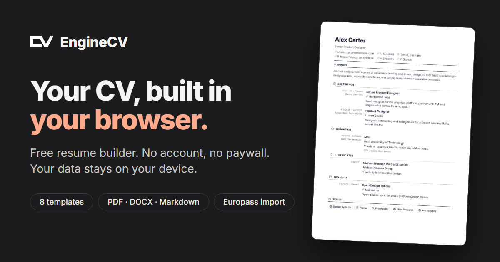

<div align="center">

<a href="https://enginecv.app">
  <picture>
    <source media="(prefers-color-scheme: dark)" srcset="./docs/assets/logo-text-light.png">
    
  </picture>
</a>

**A free, local-first resume builder. No account, no paywall, no data leaving your browser.**

[](https://github.com/enginecv/enginecv/actions/workflows/ci.yml)
[](./LICENSE)
[](https://enginecv.app)
[](./CONTRIBUTING.md)


[Website](https://enginecv.app) · [Templates](https://enginecv.app/cv-templates) · [CV examples](https://enginecv.app/cv-examples) · [Blog](https://enginecv.app/blog) · [Commit history](https://github.com/enginecv/enginecv/commits/master) · [Contributing](./CONTRIBUTING.md)

<a href="https://enginecv.app">
  
</a>

</div>

EngineCV is a local-first resume builder with live preview, flexible exports, and a product philosophy centered on privacy, utility, and low lock-in.

The goal is simple:

- let users build multiple resumes for free
- keep the core editing flow useful without an account
- let users control local terminal agents through a safe command harness in the future
- keep remote storage optional rather than mandatory

EngineCV is not intended to be another generic resume SaaS that gates basic dignity behind a paywall. The editor should remain useful even if the user never creates an account and never pays.

## What It Does

Current product capabilities include:

- dashboard for creating and managing multiple resumes
- structured editor for basics, experience, education, certificates, projects, skills, and layout customization
- live resume preview while editing
- export to `PDF`, `DOCX`, `Markdown`, plain text, `HTML`, `PNG`, `SVG`, `JSON`, and `Encrypted JSON`, plus copy to clipboard
- import from JSON, LinkedIn data-export archives, Europass CVs (PDF/XML), and public GitHub profiles
- encrypted JSON backup/import using a user-supplied key
- local persistence with IndexedDB
- version history with preview, restore, and duplicate-as-new-resume flows
- multilingual UI support

## Core Principles

EngineCV is being built around a few non-negotiables:

- local-first by default
- useful without an account
- automation should use explicit, validated, undoable product commands
- privacy should be understandable, not vague marketing copy
- payment must never gate basic editing, data access, or export

## How It Works

At a high level:

1. Resume data is edited in a structured React UI.
2. State lives in a Zustand store.
3. The current resume is validated with Zod-backed schemas.
4. The active resume is saved locally through Dexie into IndexedDB.
5. The preview renders directly from the same resume state used by the editor.
6. Exports serialize or render that resume into the chosen format.
7. Version history stores bounded snapshots so users can preview and restore older states.

This means the app works well as a client-heavy product without requiring a backend for the core experience.

## Privacy Model

EngineCV currently operates as a local-first application.

- resumes are stored locally in IndexedDB
- encrypted JSON backups are encrypted with the user’s own key
- if the user loses that encryption key, the backup cannot be decrypted
- the app itself ships no analytics code; enginecv.app counts page views with Cloudflare Web Analytics, which is cookieless and aggregate and never sees resume content (see `/privacy`, section 2)
- resume fonts are self-hosted (`@fontsource`, OFL-1.1); only fonts a user adds by URL load from elsewhere
- data leaves the device only in the cases listed on the privacy page: custom font URLs the user adds, GitHub API for GitHub import, and ads only after explicit consent (ads are off on enginecv.app)
- referral links (`/r/<slug>`) set no cookies and store nothing about the visitor; they only increment a hit counter

The current inventory of requests, cookies, and storage is on the live [privacy](https://enginecv.app/privacy) and [cookies](https://enginecv.app/cookies) pages.

The longer-term direction is optional user-controlled remote versioning, including private GitHub repositories, not mandatory EngineCV cloud storage.

## Agent Automation Direction

EngineCV does not currently ship an AI chat panel or hosted model. Planned automation connects a user-controlled local terminal agent such as Claude Code, Codex, Gemini CLI, or OpenCode through a deterministic EngineCV command harness and MCP adapter.

Agents will use validated operations for creating resumes, importing profiles, editing sections, creating targeted resumes, applying templates, and exporting. Mutations must be revision-checked, atomic, auditable, and undoable.

## Version History

EngineCV now includes a first-pass editor history system:

- autosaves are recorded into a local history table with deduping/coalescing
- users can open a `History` drawer from the editor
- a saved version can be previewed in the existing preview pane
- the selected version can be restored or duplicated as a new resume

This is currently snapshot-based. It is intentionally simple and safe before any more advanced diff-based history system is introduced.

## Monetization

No paid plan is currently offered. EngineCV has no committed monetization model yet, and the product must not advertise unimplemented plans. Any future model must preserve free local editing, data access, import, and export.

## Future Plan

The near and mid-term roadmap looks like this:

### Product

- centralized versioned preferences
- cover-letter documents
- master profiles and targeted resumes
- better import pipelines
- deterministic resume checks and job-description coverage
- richer history and restore UX
- local-agent command harness and MCP adapter
- optional private GitHub versioning

### Distribution

- `/jobs`
- `/resources`
- role-specific resume examples
- ATS content and career guides

## Tech Stack

- `Next.js` App Router
- `React 19`
- `TypeScript`
- `Tailwind CSS 4`
- `Zustand` for editor state
- `Dexie` + `IndexedDB` for local persistence
- `Zod` for schema validation
- `react-resizable-panels` for editor layout
- browser print for PDF, `docx` for DOCX, and `html-to-image` for PNG/SVG exports

## Development

Install dependencies:

```bash
npm install
```

Start the development server:

```bash
npm run dev
```

Open:

```text
http://localhost:3000
```

## Available Scripts

```bash
npm run dev
npm run build
npm run start
npm run lint
npm test
npm run test:e2e
```

For browser E2E:

```bash
npx playwright install chromium
npm run test:e2e
```

For type-checking:

```bash
npx tsc --noEmit
```

## Project Structure

Key directories:

- `src/app` - routes and page shells
- `src/components/editor` - editor, preview, export, command palette, and history UI
- `src/lib` - schema, persistence, imports, exports, preferences, and store logic
- `e2e` - Playwright end-to-end coverage
- `test` - test setup and support files

## Status

EngineCV is an active product build, not a polished finished SaaS. The README reflects both:

- what the app already does today
- and the product/business model it is being shaped toward

If you are reading the codebase to understand direction, the current implementation and the roadmap are intentionally aligned:

- local-first core
- optional local-agent automation through a constrained command harness
- public distribution surfaces for growth
- no monetization claims before working product and business model exist

## Contributing

Bug reports, fixes and translations are welcome. See [CONTRIBUTING.md](./CONTRIBUTING.md) for the workflow.

## License

The source code is licensed under the [GNU Affero General Public License v3.0](./LICENSE). The blog posts and guide copy are **not** open licensed; see [LICENSE-CONTENT.md](./LICENSE-CONTENT.md) for the exact paths and terms. The EngineCV name and logo are not covered by either licence.
